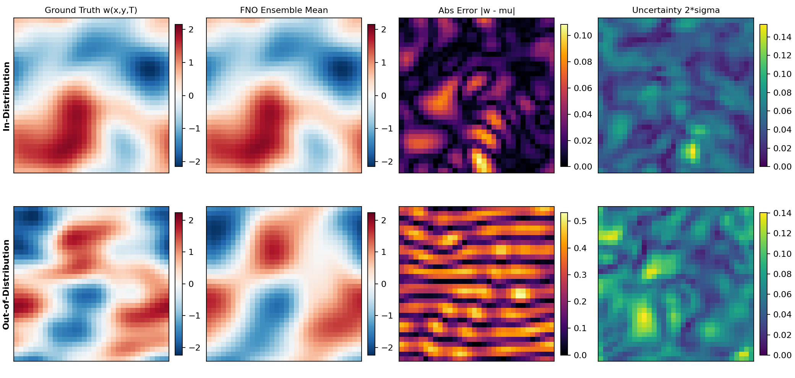
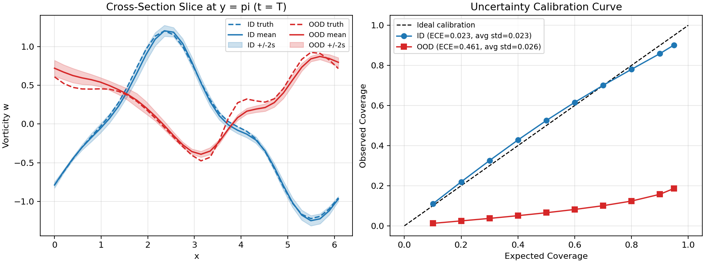

# 2D Navier-Stokes Neural Surrogate with Uncertainty Quantification

A lightweight PyTorch surrogate modeling benchmark for the **2D Incompressible Navier-Stokes equation** (vorticity-streamfunction formulation on $[0, 2\pi)^2$ with periodic boundary conditions):

$$\frac{\partial \omega}{\partial t} + \mathbf{u} \cdot \nabla \omega = \nu \nabla^2 \omega + f(x, y), \qquad -\nabla^2 \psi = \omega, \qquad \mathbf{u} = \left(\frac{\partial \psi}{\partial y}, -\frac{\partial \psi}{\partial x}\right)$$

The project compares a baseline MLP against a physics-informed 2D Fourier Neural Operator (FNO) Deep Ensemble (5 seeds), evaluating accuracy, runtime speedup over a pseudo-spectral solver, and uncertainty calibration under distribution shift.

## Project Structure

- `solver.py`: Vectorized pseudo-spectral ground-truth solver (Crank-Nicolson diffusion, RK2 advection, 2/3 dealiasing) with Taylor-Green vortex and inviscid enstrophy verification.
- `models.py`: `BaselineMLP`, `FNO2d` (2D Fourier Neural Operator), and a spectral 2D Navier-Stokes PDE residual loss (`navier_stokes_residual`).
- `uq.py`: 5-seed Deep Ensemble training, runtime benchmarking, in-distribution (ID) vs. out-of-distribution (OOD) evaluation, calibration/coverage metrics, and plot generation.

## Benchmark Results

Evaluated on a $32 \times 32$ grid over $t \in [0, 0.5]$ (5 future snapshots, CPU-only PyTorch).
- **In-Distribution (ID):** $\nu \in [5 \times 10^{-3}, 2 \times 10^{-2}]$, $k_{\max} = 4$, unforced ($f = 0$).
- **Out-of-Distribution (OOD):** $\nu \in [10^{-3}, 3 \times 10^{-3}]$, $k_{\max} = 6$, Kolmogorov forcing $f(x, y) = 0.8 \sin(4y)$.

| Model | Runtime (ms / traj) | Speedup vs. Solver | ID MSE | OOD MSE | ID 95% Cov. | ID ECE | OOD 95% Cov. | OOD ECE |
| :--- | :---: | :---: | :---: | :---: | :---: | :---: | :---: | :---: |
| Pseudo-Spectral Solver | 12.56 | 1.0x | — | — | — | — | — | — |
| Baseline MLP | 0.100 | 125.6x | `6.14e-02` | `1.12e-01` | — | — | — | — |
| FNO2d Ensemble (5 seeds + PDE loss) | 4.274 | 2.9x | `6.70e-04` | `4.11e-02` | 90.2% | 0.023 | 18.6% | 0.461 |

Key observations:
- **Accuracy:** The 2D FNO achieves **92x lower MSE** than the baseline MLP in-distribution (`6.70e-04` vs. `6.14e-02`) by learning spatial convolutions in Fourier space and regularizing with the spectral PDE residual.
- **Calibration & OOD Failure Mode:** In-distribution, the 5-member ensemble is well calibrated (`ECE = 0.023`, 90.2% empirical coverage at the 95% nominal band). Under structural OOD shift (unseen external forcing and higher Reynolds number), ensemble spread increases only slightly (`0.023` -> `0.026`) while coverage drops to `18.6%`, illustrating how deterministic ensembles remain overconfident when the governing physics changes outside the training support.

## Visualizations

### Vorticity Predictions, Error, and Spatial Uncertainty


### Cross-Section Uncertainty Bands and Calibration Curve


## Usage

```bash
# 1. Verify numerical solver accuracy (Taylor-Green vortex & inviscid enstrophy)
python solver.py

# 2. Train models, run ID/OOD UQ benchmark, and regenerate figures
python uq.py
```
